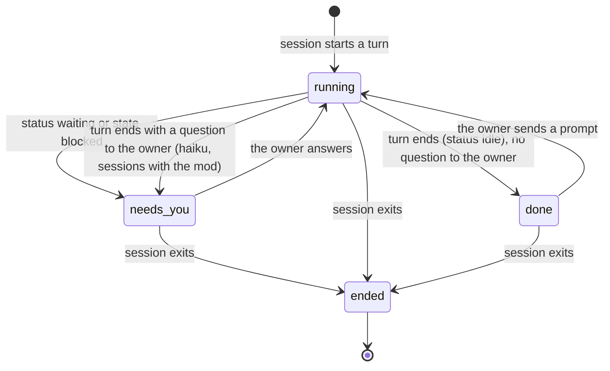
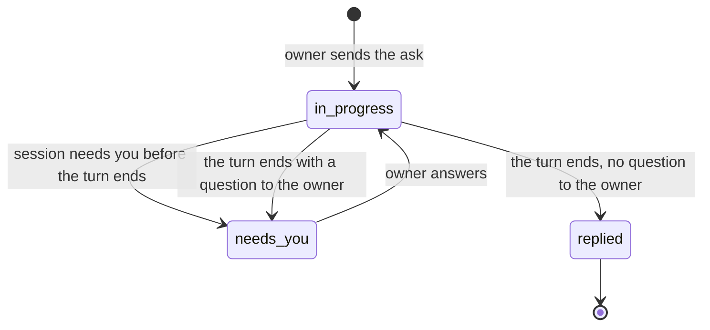

# Information Architecture

Milestone 1: the band and the pane. The pane has three pages (Home, Repo, Session); the web page in milestone 2 repeats them with links and adds Milestone and Feature pages. Routes are proposed in [the sitemap](sitemap.md); nothing exists as built.

## Objects

| Object | Definition | Status | Need |
|---|---|---|---|
| Session | One Claude Code conversation on this machine, live or ended, with its repo, worktree, branch, title, state, tokens, errors and retries. | new | J1, J4, J5, J7, J10 |
| Repo | A git repository at least one session ran in; named by its folder. | new | J1, J9, J11 |
| Worktree | A checkout of a repo (the main one or a linked worktree), with its branch. | new | J1 |
| Ask | One prompt the owner typed in a session, kept in order, classified task or question. | new | J2 |
| PR | A pull request on a repo's branch, with checks, review and mergeable state. | new | J11 |
| Run | Something running inside a session besides the main turn: a goal, a subagent or a background session (scheduled wake-ups are out of milestone 1). | new | J7 |
| Milestone | An sdlc-run milestone the session's branch belongs to (`changes/*/milestone.md`), with its features. Only in sdlc-run repos. | new | J3 |
| Feature | One row of a milestone's feature table, with its state. | new | J3 |
| Needs-you item | A session that waits for the owner: derived from the engine state, plus a stored flag "asks a question" that the session's mod writes into its own session file at turn end. | attribute of Session | J1, J5, J10 |
| Note (you should know, decided without you) | Milestone 3. Named here so milestone 1 leaves room. | deferred | J8 |

Set aside: "agent" (a session is the unit; a subagent is a Run), "task tracker item" (Beads, Linear, GitHub issues are milestone 3 links, not objects here), "plan" (milestone 3, step 5).

## Alias Table

| Canonical | Rejected | Reason |
|---|---|---|
| session | agent, conversation, chat, thread | Claude Code calls it a session (`claude agents` lists sessions). "Agent" is kept for subagents. |
| needs you | blocked, waiting, attention, needs input | The owner's own framing ("which agent needs attention"), short enough for the band. The engine states stay internal. |
| running | busy, working, active | Plain and matches "what runs in the session" (A7). |
| done | idle, finished, complete, ready for review | The turn ended and nothing asks the owner anything. |
| ended | closed, dead, stopped, exited | The session's process is gone. |
| ask | prompt, message, request | The owner's word ("what I asked for"); covers both kinds. |
| task | todo, job, work item | The owner's word. |
| question | query | The owner's word. |
| PR | pull request, merge request | Short; the owner uses it. |
| goal | loop, /goal run | The command's own name. |
| subagent | agent, worker | Claude Code's word. |
| background session | background session, job, shell | `claude agents` lists it with kind `background`. |
| repo | repository, project | "Project" is taken by sdlc-run projects. |
| compact, details | collapsed, expanded, mini, full | ponytail's labels (A6). |

## Nested Object Matrix

| Parent | Child | Cardinality | Role name | Rank |
|---|---|---|---|---|
| Repo | Worktree | 1 to many | worktrees | 2 |
| Repo | Session | 0 to many | sessions | 1 |
| Repo | PR | 0 to many | open PRs | 3 |
| Worktree | Session | 0 to many | sessions here | 1 |
| Session | Ask | 0 to many, ordered | asks | 1 |
| Session | Run | 0 to many | running now | 2 |
| Session | PR | 0 to 1 (by branch) | this branch's PR | 3 |
| Session | Milestone | 0 to 1 (by branch, sdlc-run only) | working on | 4 |
| Milestone | Feature | 1 to many, ordered | features | 1 |

## CTA Inventory

The tracker never acts on a session (no-go N1). Its verbs open, switch view, copy and go back.

| Object | Verb | Control | Type | Contra-CTA |
|---|---|---|---|---|
| Band | Switch to details / compact | band button "Details" / "Compact" | primary | the same button, renamed |
| Band | Open the pane | band button "Pane"; `/tracker` | primary | Close in the pane |
| Band | Copy the state as Markdown | band button "Copy" (details view) | secondary | none |
| Session | Open its page | row in the pane | primary | Back |
| Session (ended) | Copy its resume command | Session page button "Copy resume command" | secondary | none |
| Band | Hide or show | `/tracker band off`, `/tracker band on` | secondary | the other command |
| Repo | Open its page | repo heading in the pane; Repos line on Home | primary | Back |
| PR | Open on GitHub | PR number as a link (the mod's `Link`) | secondary | none |
| Pane | Close | Escape, "Close" | primary | `/tracker` or Pane reopens |

## Attribute Priority

| View | Attribute | Rank | Reason |
|---|---|---|---|
| Band compact | needs-you count | 1 | J1, J5: the reason the band exists. |
| Band compact | oldest waiting session: title and wait time | 2 | J1: which to answer first. |
| Band compact | running count | 3 | J5, success measure. |
| Band compact | open PR count and failing count | 4 | J11 |
| Band compact | this session's work (milestone and progress, or title) and goal age | 5 | J7; last on the line, first to be cut. |
| Band header | repo name | 1 | J7 |
| Band header | milestone and feature progress, or session title | 2 | J3, J7, J9 |
| Band header | goal and its age, subagent count, background session count | 3 | J7 |
| Pane Home row | state | 1 | J1 |
| Pane Home row | session title | 2 | J7 |
| Pane Home row | repo and branch | 3 | J1 |
| Pane Home row | time in state | 4 | J1, J10 |
| Pane Home row | tokens; errors and retries when above zero | 5 | J4 |
| Pane Repo PR row | number and title | 1 | J11 |
| Pane Repo PR row | checks, review, mergeable | 2 | J11 |
| Pane Repo PR row | session on that branch | 3 | J11 |
| Pane Session | asks in order, kind and status | 1 | J2 |
| Pane Session | running now (goal, subagents, background sessions) | 2 | J7 |
| Pane Session | milestone features (sdlc-run only) | 3 | J3 |
| Pane Session | tokens, errors, retries, started, last activity | 4 | J4 |

## State Diagrams

Session state as shown. `claude agents --json` (2.1.323, checked 2026-11-13) reports interactive sessions with `status` (`idle`, `busy`, `waiting`, plus a `waitingFor` string when waiting) and background sessions with `state` (`working`, `blocked`, `done`). Mapping: `busy` and `working` are running; `waiting` and `blocked` are needs you; `idle` is done; `done` (only with `--all`) is ended; a session missing from the list is ended. What `waitingFor` holds (permission or question) is read at build time and shown as the reason when present. A status or state not in this list (a changed engine) is shown as needs you with the reason "state unknown", never as running (decided 2026-11-14), so a waiting session is not hidden.

**A question in plain text needs you too.** Owner, 2026-11-13: "Yes, via haiku" to counting a turn that ends with a plain-text question to the owner as needs you. At the end of each turn, a session running the mod has `haiku` read its last message and flag a question to the owner, but only when the message's final paragraph holds a "?" (otherwise no call and no flag; decided 2026-11-14); that session then shows as needs you with the reason "asks a question" until the next prompt. Sessions without the mod stay "done".

**Where the check reads from:** the mod's `turn.complete` hook, then the last assistant message read from the session's own transcript (grep, as the ponytail band reads its title, because `$.fs.read` stops at 4 MiB). Not the classic `Stop` hook's `last_assistant_message`: on managed machines a security plugin skips every `classic.*` hook (seen in this session for `classic.PermissionRequest`, and stated in the ponytail band's code). The flag clears at the next `prompt.submit`.



Ask status, derived, never set by hand (no-go N6):



## Sitemap

Written by `cct:ux-sitemap-create` into [sitemap.md](sitemap.md) and [sitemap.json](sitemap.json), scoped to this change.

## Screen Inventory

| Screen | Route | Purpose | Job stories served | Arrive from | Go next to |
|---|---|---|---|---|---|
| Band, compact | above the prompt | Count what needs the owner in one line, name the oldest waiting session. | J1, J5, J10 | every session, always | Band details; Pane Home |
| Band, details | above the prompt | Columns with a count and one line each; header names this session's work. | J5, J6, J7, J11 | Band compact | Band compact; Pane Home; Copy |
| Pane, Home | pane `home` | The triage queue: needs you first, then running, then done, grouped by repo; ended today; a Repos line with PR counts. | J1, J2, J4, J9, J10, J11 | `/tracker`; band Pane | Session; Repo; Close |
| Pane, Repo | pane `repo/<repo>` | One repo: its worktrees with their sessions, and its open PRs. | J9, J11 | Home repo heading; Session's repo line | Session; Home (Back) |
| Pane, Session | pane `session/<id>` | One session: header, running now, asks in order, milestone features, numbers. | J2, J3, J4, J7 | Home row; Repo session row | Repo; Home (Back) |

## Navigation Tree

```
Band (always above the prompt)
├── compact ⇄ details            lateral (button)
└── Pane                         forward (button or /tracker)
    └── Home                     the triage queue
        ├── Repo <name>          forward (repo heading)
        │   └── Session <title>  forward (row)
        └── Session <title>      forward (row)
            └── Repo <name>      lateral (repo line in the header)
```

## Journeys

| Job story | How often | Path (screen → control → screen …) | Moves | Why this length |
|---|---|---|---|---|
| J1 answer the blocked one first | many times a session | Band compact (reads the oldest waiting session) | 0 | The most frequent job needs no move: the name is on the band. Switching to that session is Claude Code's own move, outside the tracker. |
| J5 stay aware | every prompt | Band compact | 0 | Always on. |
| J7 tell sessions apart | every prompt | Band compact Work segment (last on the line); Band details header | 0 to 1 | Compact shows the milestone and progress, or repo and title, at the end of the line and drops it first when narrow; details shows the full header. |
| J6 dig from a count to one item | several times a day | Band → Pane → Home row → Session | 2 | Pane, then the row. |
| J2 read my asks in order | daily | Band → Pane → Home row → Session (asks section) | 2 | Same as J6. |
| J4 spot struggle | daily | Band → Pane → Home (numbers on the row) | 1 | Errors and retries show on the Home row. |
| J3 see milestone progress | daily | Band details header (feature n of m); Session page for the list | 0 to 2 | Progress on the header, list one level down. |
| J11 open PRs and their state | daily | Band → Pane → Repo heading → Repo (PRs) | 2 | Home shows a PR count per repo; the list is on Repo. |
| J9 without sdlc-run | as above | as above | as above | Same paths; milestone parts are absent. |
| J10 pushed attention | continuous | Band compact turns warning colour | 0 | The band is in every session. |

## Move Table

| From | Control | To | Type | Why (job story or ask) | Back target | Restores |
|---|---|---|---|---|---|---|
| Band compact | Details | Band details | lateral | J6, A6 | Band compact (Compact) | nothing to restore |
| Band details | Compact | Band compact | lateral | J5, A4, A6 | Band details (Details) | nothing to restore |
| Band (either) | Pane | Pane Home | forward | J6, A8, A9 | close the pane | prompt focus and draft |
| Prompt | `/tracker` | Pane Home | forward | J6, A8 | close the pane | prompt focus and draft |
| Pane Home | session row | Pane Session | forward | J2, J6 | Pane Home | selected row, scroll |
| Pane Home | repo heading | Pane Repo | forward | J11, A8 | Pane Home | selected heading, scroll |
| Pane Repo | session row | Pane Session | forward | J6 | Pane Repo | selected row, scroll |
| Pane Session | repo line in the header | Pane Repo | lateral | J11 | Pane Session | selected row, scroll |
| Pane (any page but Home) | Back button | previous pane page | back | every forward move | | the previous page's focused row and scroll |
| Pane (any page) | Close button or `ctrl+x x` (Escape only returns the keys) | prompt | up | return to work | | prompt focus and draft |

The pane has no raw key handler (the mod API gives Buttons, Tab, Enter and one-character hotkeys only), so every move is a Button: rows are Buttons, Back and Close are Buttons with hotkeys.

## Decisions Taken Here

- **Default band view:** compact. A new session, or one with nothing stored, starts compact. The choice is kept machine-wide in `~/.claude/agent-tracker/settings.json` (inside the one folder the tracker writes), so every session's band follows on its next redraw (one band everywhere, A6). Conformance F013.
- **Band order, count first:** the compact line starts with the needs-you count, then running, PRs, and this session's work last. The owner's own sketch in the design file reads `● 2 need you ◐3 … PRs 1✗` with the session after it. Conformance F016.
- **This session waiting:** it counts, and the band names it "this session" instead of its title; the oldest other waiting session follows when there is one. Conformance F008.
- **Pane entry:** the Pane button and `/tracker` always open Home, the triage queue (scene S2). `/tracker repo <name>` and `/tracker session <text>` open those pages. Conformance F006.
- **Route to a waiting session (J1):** the tracker cannot switch sessions (observe only). The band and Home name the session by its title, which is the title of its Claude Code tab. An ended session's page offers "Copy resume command" (`cd <folder> && claude --resume <id>`); a live session's page does not, because resuming a live session starts a second process on it. Conformance F005.
- **Every repo has a way in from Home:** Home ends with a "Repos" line listing every repo with a session in the last 7 days, each a button to its Repo page with its PR count. Conformance F009.
- **Next to ponytail's band:** the tracker draws its own row above the rows of other mods (`next(e)` below), shares no hotkey with them (ponytail's buttons have none), and `/tracker band off` hides it, `/tracker band on` shows it again. Conformance F011.
- **Feature states:** shown as "to do", "building", "complete", "merged", "blocked"; "done" stays the word for a session whose turn ended. Conformance F009 note.
- **Done count on the band:** the compact line shows "✓ 2 done" next to running, so sessions whose turn ended are visible even when nothing needs you (validation, reviewers 1 and 2).
- **Stable rows:** the pane's row order is frozen while it has the keyboard; a newly waiting session is added at the end marked "new". Focus starts on the first row (validation, reviewer 2).
- **Session page order:** header, Running now, Usage (one line), Milestone, then Asks last, the one list without a bound (validation, reviewers 1 and 3).
- **Beads:** nothing from `bd` shows in milestone 1; Beads links come with milestone 3. The "without bd" state is removed.
- **Breadcrumb root:** "Home", as in the sitemap; the pane's title row says "Tracker". The breadcrumb is text; the repo button in the Session header is the control. Conformance F004.
- **Ended sessions:** Home has an "Ended today" section (since local midnight, at most 5); the Repo page lists the last 7 days under "Ended". Changed after validation: reviewers 1 and 3 each found that after a run the session is usually ended, so the review scene (S3) needed four moves without it.
- **Repo identity:** the git top-level path; the label is its folder name. Two repos with the same folder name get the parent folder added to both labels (`work/web-app`, `oss/web-app`). Sitemap finding SM-6.
- **Page ids singular** (`repo/<repo>`, `session/<id>`): kept to match the alias table and milestone 2's `#/repo/…` routes. Sitemap finding SM-10. Owner, 2026-11-13: "Keep singular"; exception EX-1.
- **One entry, three names** (`/tracker`, the Pane button, the Home page): the pane's title is "Tracker", the band button says "Pane" (the design file's button set; ponytail's band has Board where this has Pane), the first page is Home. Sitemap finding SM-4. Owner, 2026-11-13: "Keep as is".

## Open Questions

| Question | Recommended answer | Why it matters |
|---|---|---|
| Does a session that finished its turn (engine `idle`) count as needs you? | Answered by the owner, 2026-11-13: only when its last message asks the owner a question ("Yes, via haiku"); otherwise "done". | Counting every idle session would make the band's main number meaningless. |
| Is the band also shown in the session that needs the owner? | Yes, the same band in every session; the session's own state is in its header. | One band everywhere is predictable. |
