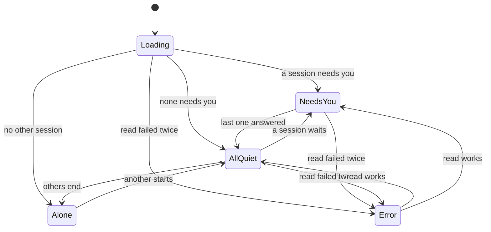

# Interaction

Every guideline in `docs/ux/interaction-guidelines.md` is `unresolved`. Each row below cites the rule area it proposes a default for (`IG: <area>`); the owner accepts or changes them at the gate.

What the mod API allows, and so what this spec uses (Claude Code 2.1.323 types, checked 2026-11-13):

- **Band keys:** `ctrl+x tab` or a click gives the band the keyboard; Tab and the arrows walk its buttons, Enter presses one, a one-letter `hotkey` presses it directly. Escape hands the keyboard back to the prompt. Digit hotkeys are not used: a bare digit in an empty prompt would press them.
- **Pane keys:** the same ring (`ctrl+x tab`, Tab, Enter, letter hotkeys, arrows scroll). No raw key handler, so every move is a Button. `ctrl+x x` closes a pane; the pane opens with `closeOnEscape`, so Escape at an empty prompt closes it too.
- **Menu route:** the mod has no menus. The menu route for every action is the `/tracker` command with an argument (`/tracker details`, `/tracker compact`, `/tracker copy`, `/tracker repo <name>`, `/tracker session <title or id>`).
- **Refresh:** the collector reads `claude agents --json` every 5 seconds and the session files on change; the band and an open pane redraw when the data changes, never more often.

## Wireflows

### J1 Answer the blocked one first

| From control | Action | To screen or state | Notes |
|---|---|---|---|
| (none) | a session starts to wait | Band compact: needs you | Every session's band turns the count to the warning colour within 5 seconds. |
| Band compact: oldest waiting segment | read | (no move) | Names the session title and its repo, and how long it has waited. Switching to that session is Claude Code's own move. |

### J2 Read my asks in order

| From control | Action | To screen or state | Notes |
|---|---|---|---|
| Band: Pane button (`p`) | press | Pane Home | Pane opens with the keyboard. |
| Pane Home: session row | Enter | Pane Session | Asks section is first after the header. |
| Pane Session: Back (`b`) | press | Pane Home | Same row focused. |

### J3 See milestone progress

| From control | Action | To screen or state | Notes |
|---|---|---|---|
| Band compact: Details (`d`) | press | Band details | Header row: milestone, "feature 2 of 4". |
| Band details: Pane (`p`) | press | Pane Home | |
| Pane Home: session row | Enter | Pane Session: Milestone section | Lists features with state. Absent without sdlc-run. |

### J4 Spot where a session struggles

| From control | Action | To screen or state | Notes |
|---|---|---|---|
| Band: Pane (`p`) | press | Pane Home | Each row shows tokens, and errors and retries when above zero. |
| Pane Home: session row | Enter | Pane Session: Numbers section | Tokens in and out, tool errors, retries, started, last activity. |

### J5 Stay aware while typing

| From control | Action | To screen or state | Notes |
|---|---|---|---|
| (none) | the session starts | Band compact | Default view. No move needed. |

### J6 Dig from a count to one item

| From control | Action | To screen or state | Notes |
|---|---|---|---|
| Band compact: Details (`d`) | press | Band details | Columns: needs you, running, done, PRs. |
| Band details: Pane (`p`) | press | Pane Home | |
| Pane Home: session row | Enter | Pane Session | |

### J7 Tell sessions apart

| From control | Action | To screen or state | Notes |
|---|---|---|---|
| (none) | read | Band compact: first segment | Repo, then milestone or session title. |
| Band compact: Details (`d`) | press | Band details: header row | Adds what runs: goal and its age, subagents, background tasks. |

### J9 Without sdlc-run

| From control | Action | To screen or state | Notes |
|---|---|---|---|
| (any of the above) | | same screens | Milestone parts are absent; the header shows the session title and branch instead. |

### J10 Pushed attention

| From control | Action | To screen or state | Notes |
|---|---|---|---|
| (none) | a session starts to wait | Band compact: needs you, warning colour | In every session. No notification, sound or toast in milestone 1: Claude Code already notifies for its own session, and a tracker notifying from every session would repeat it once per open session. |

### J11 Open PRs and their state

| From control | Action | To screen or state | Notes |
|---|---|---|---|
| Band: Pane (`p`) | press | Pane Home | Each repo heading shows "3 PRs · 1 failing". |
| Pane Home: repo heading | Enter | Pane Repo | PRs section lists each PR. |
| Pane Repo: PR number link | Enter | the browser | Opens the PR on GitHub. |
| Pane Repo: session on the PR's branch | Enter | Pane Session | |

## State Tables

### Band, compact

| State | Entry or trigger | What the user sees | Words | Actions with key | Exit |
|---|---|---|---|---|---|
| Loading | session start, before the first read | the header segment and a dim placeholder | "tracker · reading sessions…" | Details `d`, Pane `p` | first read done |
| Needs you | at least one session needs you | warning-coloured count, then the oldest waiting session and its wait | "● 2 need you · web-app: fix login, 6m" | Details `d`, Pane `p` | none needs you |
| All quiet | sessions run or are done, none needs you | counts in normal colour | "◐ 3 running · ✓ 2 done" | Details `d`, Pane `p` | a session needs you |
| Alone | this is the only live session | the header only, dim | "only this session" | Details `d`, Pane `p` | another session starts |
| Partial | `gh` or `bd` missing or failing; sessions still read | the counts without the PR segment | as All quiet, without "PRs" | Details `d`, Pane `p` | the tool works again |
| Error | `claude agents --json` failed twice in a row | the header and one dim line with the reason | "tracker · sessions unavailable: claude agents failed. Retrying every 5s." | Details `d`, Pane `p` | the next read works |

### Band, details

| State | Entry or trigger | What the user sees | Words | Actions with key | Exit |
|---|---|---|---|---|---|
| Default | Details pressed, or kept from last time | header row, buttons right; columns below, each a label, a bold count and one dim line | header: "calvins-claude-tools · agent-tracker-1 · feature 2 of 4 · goal 14m · 2 subagents" | Copy `c`, Pane `p`, Compact `d` | Compact |
| Column empty | a column has 0 | the count 0 and no dim line | "needs you / 0" | as Default | |
| Loading, Partial, Error | as compact | as compact, the line under the header | as compact | as Default | as compact |
| Narrow | `bodyColumns` below 80 | the columns drop their dim line; below 60 they fold to two rows | | as Default | wider |

### Pane, Home

| State | Entry or trigger | What the user sees | Words | Actions with key | Exit |
|---|---|---|---|---|---|
| Loading | opened before the first read | the title and a dim line | "Reading sessions…" | Close `x` | first read |
| Default | sessions exist | sections Needs you, Running, Done; each lists rows grouped under repo headings | see screens.md | Enter on a row or heading, Close `x` | Session, Repo, close |
| All quiet | none needs you | the Needs you section shows one line | "Nothing needs you." | as Default | |
| Empty | no live session but this one | one line | "Only this session is running. Sessions in other terminals show up here when they start." | Close `x` | a session starts |
| Partial | gh or bd missing | rows as Default; repo headings without PR counts; one dim line at the bottom | "PRs not shown: gh is not installed or not signed in." | as Default | |
| Error | sessions unreadable | the last good list, dim, and a line at the top | "Sessions unavailable: claude agents failed. Showing what was read 2m ago." | as Default | next read |

### Pane, Session

| State | Entry or trigger | What the user sees | Words | Actions with key | Exit |
|---|---|---|---|---|---|
| Live | a row of a live session | header, Running now, Asks, Milestone (sdlc-run only), Numbers | see screens.md | Back `b`, repo line, Close `x` | Back, close |
| Ended | the session left `claude agents` while open | the same, header state "ended", the time it ended | "Ended 4m ago" | as Live | |
| From transcript | a session without the mod | Asks and Numbers from its transcript; asks not classified are marked so | "kind not known: this session ran without the tracker" | as Live | |
| No asks | no prompt yet | Asks section one line | "No asks yet." | as Live | |
| Not found | the session id is unknown (command argument) | one line | "No session matches \"<text>\". Open the pane to pick one." | Close `x`, Home `h` | |

### Pane, Repo

| State | Entry or trigger | What the user sees | Words | Actions with key | Exit |
|---|---|---|---|---|---|
| Default | a repo heading | Worktrees with their sessions, Open PRs, Ended | see screens.md | Back `b`, rows, PR links, Close `x` | Back, close |
| No PRs | gh works, none open | PR section one line | "No open PRs." | as Default | |
| No gh | gh missing or signed out | PR section one line | "PRs not shown: gh is not installed or not signed in. Run gh auth login to see them." | as Default | |
| Not found | unknown repo name (command argument) | one line | "No repo named \"<text>\" has had a session." | Close `x`, Home `h` | |

## State Diagrams

Band view is a separate two-state toggle (compact, details), kept across sessions.

## Elements x Interactions

"nothing" means the element ignores the gesture. No element accepts drag, drop or right-click: the mod draws no menus and takes no files.

| Screen | Element | Click | Double-click | Drag | Drop onto | Hover | Right-click / More | Keys | Selection | Rules |
|---|---|---|---|---|---|---|---|---|---|---|
| Band | view button (Details / Compact) | toggles the view | toggles twice (no net change) | nothing | nothing | nothing | nothing | `d` when focused; Enter | nothing | IG: remembered state |
| Band | Pane button | opens the pane with the keyboard | opens once (already open: focuses it) | nothing | nothing | nothing | nothing | `p`; Enter | nothing | IG: side panels |
| Band | Copy button (details) | copies the state as Markdown, toast | copies twice | nothing | nothing | nothing | nothing | `c`; Enter | nothing | IG: copy and paste |
| Band | counts and text | nothing | nothing | nothing | nothing | nothing | nothing | nothing | nothing | IG: lists and selection |
| Pane | session row | opens Session | opens once | nothing | nothing | nothing | nothing | Enter when focused; Tab and arrows move | one focused row, no multi-select | IG: lists and selection |
| Pane | repo heading | opens Repo | opens once | nothing | nothing | nothing | nothing | Enter | as session row | IG: lists and selection |
| Pane | PR number link | opens the PR in the browser | opens once | nothing | nothing | nothing | nothing | Enter | as session row | IG: navigation and return |
| Pane | ask row | nothing (text only) | nothing | nothing | nothing | nothing | nothing | arrows scroll | nothing | IG: lists and selection |
| Pane | Back button | previous page | goes back twice | nothing | nothing | nothing | nothing | `b`; Enter | nothing | IG: navigation and return |
| Pane | Home button | Home | Home | nothing | nothing | nothing | nothing | `h`; Enter | nothing | IG: navigation and return |
| Pane | Close button | closes the pane, keys to the prompt | closes | nothing | nothing | nothing | nothing | `x`; Enter; `ctrl+x x`; Escape at an empty prompt | nothing | IG: keyboard and focus |

## Action Behaviour

Nothing the tracker does changes anything outside its own folder, so nothing needs confirming and nothing needs undo.

| Action | Pointer route | Keyboard route | Menu route | Save | Leave | Undo | Guideline |
|---|---|---|---|---|---|---|---|
| Switch band view | click Details / Compact | `ctrl+x tab`, `d` | `/tracker details`, `/tracker compact` | saved at once, kept across sessions | nothing to lose | press again | IG: remembered state |
| Open the pane | click Pane | `ctrl+x tab`, `p` | `/tracker` | nothing | nothing | Close | IG: side panels |
| Copy the state | click Copy (details) | `ctrl+x tab`, `c` | `/tracker copy` | nothing | nothing | not needed (clipboard only) | IG: copy and paste |
| Open a session | click its row | `ctrl+x tab`, Tab to the row, Enter | `/tracker session <title or id>` | nothing | nothing | Back | IG: navigation and return |
| Open a repo | click its heading | Tab to the heading, Enter | `/tracker repo <name>` | nothing | nothing | Back | IG: navigation and return |
| Open a PR | click its number | Tab to it, Enter | none (the browser is outside the tracker) | nothing | nothing | close the browser tab | IG: navigation and return |
| Go back | click Back | `b` | `/tracker` (Home) | nothing | nothing | open again | IG: navigation and return |
| Close the pane | click Close or the close mark | `x`, `ctrl+x x`, Escape at an empty prompt | none | the page and focused row are kept for the next open | nothing | `/tracker` reopens on the same page | IG: keyboard and focus |

## Feedback

| Action | Feedback | Reason | Where shown |
|---|---|---|---|
| Switch band view | visible: the band redraws | the change is the feedback | band |
| Open the pane | visible: the pane appears with the keyboard | | pane |
| Copy the state | visible: toast "Tracker state copied as Markdown", or "Copy failed: <reason>" | the clipboard shows nothing by itself; the toast carries nothing the user needs later | toast |
| A session starts waiting | visible: count and colour change in every band | J10 | band |
| A read fails | visible: dim line on the band, top line in the pane | the data shown may be old; never only a toast | band, pane |
| The store cannot be written | visible: status line "tracker: could not save this session's file: <reason>" | asks of this session may be lost | status line under the prompt |

## Errors

| Event | Consequence | Action |
|---|---|---|
| `claude agents --json` failed or timed out. | Session states are not updated; the band shows the last read and its age. | It retries every 5 seconds; update Claude Code if it keeps failing. |
| `gh` is not installed or not signed in. | PR counts and the PR list are not shown. | Run `gh auth login` to see them. |
| `bd` is not installed. | Beads work is not shown (milestone 3 only). | Install Beads to see it. |
| A transcript could not be read (too large, missing, malformed). | That session shows without asks or numbers. | Nothing to do; it is shown again when the file can be read. |
| This session's tracker file could not be written. | Its asks from now on are not kept. | Check that the home folder's `.claude/agent-tracker` folder is writable. |
| The ask could not be classified (model call failed). | The ask is kept, its kind shown as "not classified". | Nothing to do; the next ask is tried again. |
| Copy failed. | Nothing was copied. | Try again, or use `/tracker copy`. |

## Open Questions

| Question | Recommended answer | Why it matters |
|---|---|---|
| Should the tracker send one notification when a session starts waiting? | No in milestone 1 (J10 is met by the band in every session). Revisit if a waiting session is still missed. | One notification per open session would repeat Claude Code's own. |
| Should the pane open on the page it was closed on? | Yes, with the same row focused. | Matches "Back restores"; the owner usually returns to the same session. |
