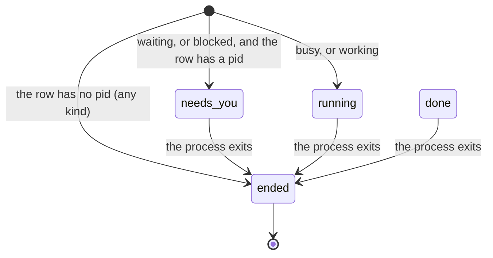
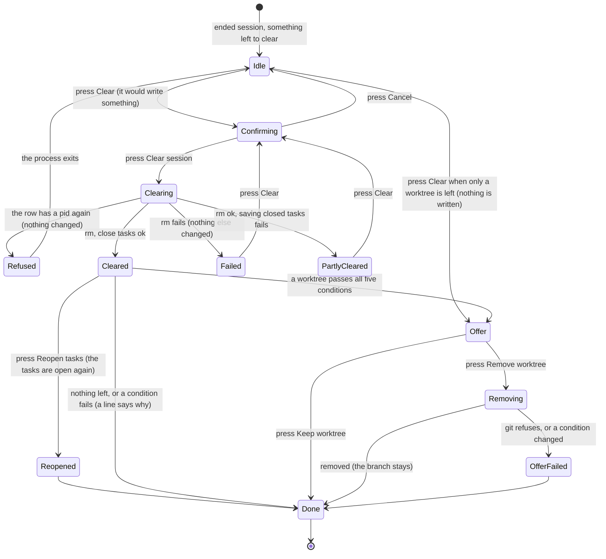

# Information Architecture

This change adds no page and no address. It changes what a session is called when its process is gone and adds three controls to the Session page. Tidying many stale items is the skill `git-cleanup-run`, outside the pane (owner, dialog, 2026-11-14). Milestone 1's [ia.md](../../2026-11-13-agent-tracker/spec/ia.md) stays the base: objects, alias table, navigation tree and move table are not repeated, only what this change adds or changes. The routes are in [sitemap.md](sitemap.md). Evidence for every as-built claim is the built code on `milestone/agent-tracker-4` at `935c8d6` (2026-11-14), under `plugins/agent-tracker/hooks/tracker/`, cited as `file:line`.

## Objects

| Object | Definition | Status | Need |
|---|---|---|---|
| Session | One Claude Code conversation. **Changed:** it now carries a "process" fact: whether `claude agents --json` gives its row a `pid`. A listed row with no `pid` is a session whose process is gone. | changed | J1, J6 |
| Ended session | A session with no process: absent from Claude Code's list, listed with no `pid` (an exited background session keeps `state: blocked`), or a background row reported `done`. An interactive row that reports `idle` with a `pid` is not ended: it is done and has a terminal. Words on screen: "ended". The no-`pid` rule applies to every row, interactive or background (supervisor decision, 2026-11-14). It is observed for background rows; for interactive rows without `pid` it is an assumption, with a fixture in the build. and only when the same read shows `pid` on at least one row; with no `pid` anywhere in a good read the tracker says so and withholds Clear ("Pid not reported"). This session's own id is never ended by it. A live background row that lacks `pid` while others have one would still read as ended: Stage 3 records a fixture of a live background row, and it is the one residual risk. | changed (was: absent or `done` only; `core/states.ts:46`, `:63`) | J1 |
| Last activity | When the session last did anything: a prompt, a turn end, or the last line of its transcript. Replaces the clock time of the first sighting as the answer to "how old is this". | changed | J2 |
| Task | An ask of kind task that nobody has finished, with one status (needs you, forgotten, superseded, in progress). Closed by the owner with Close, or now by Clear. | existing (`core/tasks.ts:81`) | J3 |
| Clear | An act on one ended session, after one confirm that says what will happen (owner, dialog, 2026-11-14: "Always confirm"). When Clear session is pressed it re-reads `claude agents --json` and stops if the row now has a `pid`; it leaves Claude Code's list (`claude rm`, only when still listed; `claude rm` also deletes a worktree the session itself created, if safe); it closes the tasks Home lists for that session (the same set: forgotten, superseded, in progress; a task whose verdict is "done" is not listed, so not closed); a worktree offer follows. "Reopen tasks" undoes the closing while the owner is on the page. | new | J3, J4 |
| Worktree (linked) | A checkout other than the repo's main one, where the session's `cwd` is. Safe to remove only when all five conditions in "Decisions Taken Here" hold. | existing, gains an action | J4, J6 |
| Cleanup pass | One run of the skill `git-cleanup-run`: its script lists the stale items with each check's result, subagents summarise them, Claude asks one question per batch, the script acts on the chosen ids and reports. It exists only in the transcript of the session that ran it. The tracker stores nothing of it. | new, transient, outside the pane | J5 |
| Stale item | An ended session idle 30 days or more for which Clear would still do something; or a linked worktree whose idle time is 30 days or more, where idle time is the newest of its branch's last commit, the folder's last change and its sessions' last activity (unknown means not stale, so a worktree made today is never collected), with no live session in it, and that passes every check; an item that fails a check is listed as "needs a look" and never acted on. Listed by the script on every run. Nothing stores it. | new, derived | J5 |

Set aside: "dead session" as a screen word (the alias table already rejects it for "ended"); "archive" (the intent keeps the conversation, nothing is archived); a stored "cleared" flag (a cleared session is recognised by having nothing left to clear, so no new field is kept).

## Alias Table

Rows below add to milestone 1's alias table. The pane's existing words stay.

| Canonical | Rejected | Reason |
|---|---|---|
| Clear (a session) | close, remove, delete, dismiss, archive, drop | The owner's own word: "Clear button" (A6). Close already has two meanings on the pane (the pane's Close button, and Close on one task); a third on sessions would blur them. |
| close (a task) | clear, dismiss | Unchanged. The result line of Clear says "2 tasks closed", the same verb as the task's own Close button. |
| Remove (a worktree) | delete, clean up, prune | `git worktree remove` is the operation; the branch stays, so it is not deleted. |
| Tidy | sweep, prune, housekeeping | The owner's word, now the skill `git-cleanup-run` (A6, owner 2026-11-14). The word "cleanup" names the skill; Home, the band and the pane have no Tidy. |
| idle (for 30 days or more) | stale, old, abandoned, dead | "Stale" is the intent's word; the owner reads "idle" on the screen. "Stale" stays in the spec only. |
| ended | dead, exited, stopped, closed | Unchanged (milestone 1). A session whose process is gone is "ended", however Claude Code lists it. |
| terminal | process, pid, window | The owner closes a session in its terminal; "process" and "pid" are system words. |
| last activity | since, updated, seen | "Since 16:13" read as the age of the session; it was the clock time the tracker first saw it. |

Which Close survives where: **Close** (the pane button, top right of every page) closes the pane. **Close** on a task row (Home, superseded tasks only) closes that task. **Clear** (a session's page) acts on a session. No page shows two of them at once on the same object.

## Nested Object Matrix

Milestone 1's matrix holds. Additions:

| Parent | Child | Cardinality | Role name | Rank |
|---|---|---|---|---|
| Session | Task | 0 to many | tasks | 1 (the list Clear closes) |
| Session | Worktree (linked) | 0 to 1 (by `cwd`) | its worktree | 2 |
| Cleanup pass | Batch | 0 to 2 (sessions; worktrees). Items that failed a check are not a batch: they are named in the report. | batches | 1 |
| Batch | Item | 1 to many | items | 1 |

## CTA Inventory

The tracker now acts, only on an explicit owner action. Every verb below is one press or one command; none runs by itself.

| Object | Verb | Control | Type | Contra-CTA |
|---|---|---|---|---|
| Session (ended) | Clear | Session page button "Clear" (opens a confirm; nothing is written yet) | primary (a rank, not a style: every action is a plain Button) | "Reopen tasks" while the owner is on the page. The conversation is kept ("Copy resume command", while the worktree folder exists); the list row does not come back. |
| Session (confirming) | Clear | button "Clear session" inside the confirm | primary (of the confirm) | "Cancel"; then "Reopen tasks" while the owner is on the page |
| Session (confirming) | Cancel | button "Cancel" | secondary | press Clear again |
| Session (ended) | Copy its resume command | Session page button "Copy resume command" (now ended sessions only) | secondary | none |
| Worktree (linked, after Clear) | Remove | button "Remove worktree" inside the offer | primary (of the offer) | "Keep worktree" |
| Worktree (offer) | Keep | button "Keep worktree" | secondary | the offer returns the next time Clear is pressed |
| Pane | Close | unchanged | primary | unchanged |

## Attribute Priority

| View | Attribute | Rank | Reason |
|---|---|---|---|
| Session page header | state ("○ ended 63d ago") | 1 | J1, J2 |
| Session page, first line | branch; started; last activity | 2 | J2: age first-class |
| Session page | tasks, with their state glyphs | 3 | J3: the list Clear will close |
| Session page | worktree line (label; why it stays) | 4 | J4 |
| Session page | actions: Clear, Copy resume command | 5 | J3 |

## State Diagrams

Session state as shown, with this change's transition. Milestone 1's diagram (`ia.md`) is otherwise unchanged. Mapping from `claude agents --json` (checked 2026-11-14): interactive rows carry `pid` and `status`; background rows carry `state`; a background row that exited keeps `state: blocked` and has no `pid`.



What it does to the lists, from `core/tasks.ts` and `core/rank.ts`:

- The session leaves NEEDS YOU, the band count and the needs-you rows of "Your tasks not done" (`isNeedsYou` needs `isLive`, which needs a state other than ended).
- Its task asks from the last 7 days become **Forgotten** (red, "session ended 2h ago, not done") when the last verdict is "partly" or "not started"; with no verdict they become unchecked and leave the list; a task with verdict "done" is not listed.
- A task asked more than 7 days ago never lists, as before. So the state fix alone removes the 63-day and 88-day rows; Clear is for sessions that ended within the week; the skill `git-cleanup-run` is for old ones.

Clear, as states of one Session page:



## Sitemap

Written into [sitemap.md](sitemap.md) and [sitemap.json](sitemap.json), scoped to this change: As built (the pane's pages and command words read from the code), Proposed, Changes from as built, Redirects. Not copied here.

## Screen Inventory

| Screen | Route | Purpose | Job stories served | Arrive from | Go next to |
|---|---|---|---|---|---|
| Pane, Home (changed) | `home` | Open tasks lead; needs-you holds only live sessions. No Tidy block. | J1 | `/tracker`; band Pane; Back | Session; Repo |
| Pane, Session (changed) | `session/<sessionId>` | One session: its real age, tasks, worktree, and for an ended one the Clear action. | J1, J2, J3, J4, J6 | Home row or task row; Repo row | Repo; Home (Back); the result lines on the same page |
| Band, compact and details (unchanged) | `band/compact`, `band/details` | Counts. The needs-you count drops dead sessions; no cell is added. | J1 | every session | Pane |
| Cleanup pass, in the transcript | none (the owner's session transcript) | The skill's batch questions and its final report. | J5, J6 | the skill `git-cleanup-run` | none |
| Board, Session view (unchanged page) | `#/session/<id>` | Shows the same state; no actions (N9). | J1, J2 | the Board | the Board |

## Navigation Tree

```
Band (always above the prompt)                unchanged
└── Pane
    └── Home
        ├── Repo <name>
        │   └── Session <title>
        └── Session <title>                   (a task row or a session row)
            ├── Clear / Remove worktree / Keep worktree   act on this page, stay on it    new
            └── Repo <name>                   lateral
```

The prompt also reaches `/tracker session <text>`. The skill `git-cleanup-run` is reached by its own name, not through the tracker.

## Journeys

| Job story | How often | Path (screen → control → screen …) | Moves | Why this length |
|---|---|---|---|---|
| J1 trust the needs-you list | every glance | Band compact, Home NEEDS YOU | 0 | A state fix, not a path. |
| J2 see an old session's real age | weekly | Band → Pane → Home row → Session | 2 | The same two moves as any session page (M1-J2). |
| J3 clear a session and its tasks | weekly | Band → Pane → Home task row → Session → Clear → Clear session | 4, one confirm | Two moves to the page, two to act (Clear, then its confirm). The owner chose "Always confirm" (2026-11-14). From the prompt: `/tracker session <text>` → Clear → Clear session is 2. |
| J4 remove the merged worktree | weekly | …→ Clear → Clear session → Remove worktree | 5, two confirms | After Clear; the second confirm is the offer itself. When nothing but the worktree is left, Clear opens the offer directly: 4, one confirm. |
| J5 clean up many | monthly | Prompt → `/git-cleanup-run` | 1, then one answer per batch | Rare, so it is a skill outside the pane, not a pane control. |
| J6 leave running work alone | every Session page | Session page of a live session | 0 | No Clear is drawn; one line says why. |

## Move Table

Milestone 1's move table holds. Additions:

| From | Control | To | Type | Why (job story or ask) | Back target | Restores |
|---|---|---|---|---|---|---|
| Pane Session (ended) | Clear | Pane Session (confirm) | in place | J3, A3, A4 | Back goes to the page before the Session page | focus on Cancel |
| Pane Session (confirm) | Cancel | Pane Session | in place | J3 | as above | focus on Clear |
| Pane Session (confirm) | Clear session | Pane Session (result lines; the offer above them when there is one) | in place | J3, A3, A4 | as above | focus on Keep worktree when the offer shows, else on the first action; the Back target's row may be gone (the cleared session's task row), so focus lands on the next row, else the first |
| Pane Session (offer) | Remove worktree | Pane Session (result) | in place | J4, A4 | as above | focus on the first action |
| Pane Session (offer) | Keep worktree | Pane Session | in place | J4 | as above | focus on the first action |
| Prompt | `/git-cleanup-run` | the owner's transcript | forward | J5 | none | prompt focus |
| Prompt | `/tracker session <text>` | Pane Session | forward | J3 (a keyboard route to Clear) | close the pane | prompt focus and draft |

Clear never moves the owner to another page: its result stays on the page so the owner sees what changed next to the tasks it closed.

## Decisions Taken Here

- **A session without a process is ended (J1), with a guard.** The rule is the owner's own spot check: "no `pid`". It applies to both kinds of row, but only when the same read shows a `pid` on some row (a changed Claude Code must not turn every session into "ended"; this session's own interactive row always has one). Words stay "ended"; "dead" is not a screen word.
- **Last activity is the age (J2).** The first line of the page reads `started <when> · last activity <ago>`. `<when>` is `16:13` today, `Tue 16:13` from yesterday to 6 days back, `12 Sep 16:13` older, `12 Sep 2025 16:13` older than a year. Local time. The weekday alone is wrong past 7 days (`when()` in `core/pane-model.ts` does that today), which is why a date is added.
- **Clear always asks one confirm (owner, dialog, 2026-11-14: "Always confirm").** Pressing Clear replaces the actions row with a confirm block: it says what will happen (the tasks it closes, the list entry it removes, a worktree Claude Code would remove, what is kept), then "Clear session" and "Cancel". Focus lands on Cancel, so a stray Enter never clears. Nothing is written and the list is not re-read until Clear session is pressed. When Clear would write nothing (only a removable worktree is left) there is no confirm: Clear opens the offer, which is its own. The result lines say what happened; "Reopen tasks" undoes the closing while the owner is on the page. The list row does not come back; the conversation stays (while its folder exists). The worktree offer is a second confirm (J4).
- **`claude rm` may remove a worktree the session made (owner, dialog, 2026-11-14: "Allow, name it (Recommended)").** The confirm names it before the press, with "if" because Claude Code decides; the result names it after.
- **The button word stays "Clear" (owner, dialog, 2026-11-14: "Keep "Clear" (Recommended)").**
- **Clear does what is left.** An ended session absent from Claude Code's list gets no `claude rm` (nothing to remove: a fact for Stage 3); it still closes tasks and offers the worktree. A session with nothing left shows "Nothing to clear" and no Clear button.
- **Five conditions for the worktree offer (J4, N2, N5).** All must hold, each checked by code (never by a model) when the page opens and again when Remove is pressed: (1) the session's `cwd` is a linked worktree, not the main checkout (no line at all otherwise); (2) it has no modified, staged or untracked files; (3) it has no commits that are not pushed; (4) its branch is merged into the default branch, or its PR is merged or closed; (5) no live session uses it. Ignored files (such as `.env`) are deleted with the worktree: the offer lists them (up to 3 names, then "and N more") and is never refused because of them (owner, dialog, 2026-11-14: "List them in the offer (Recommended)"); the list is re-read when Remove is pressed, and a changed list removes nothing. Conditions 1 and 5 are not in the intent; they follow from J6 and N1. Removal never forces and keeps the branch. A failed condition shows one line naming it.
- **Re-check after `claude rm`, and before it.** When Clear session is pressed (not when Clear opens the confirm), Clear re-reads the session list immediately before `claude rm`; if the row now has a `pid` it does nothing and says so ("This session is running again. Nothing was changed."). After `claude rm`, the worktree is checked again, because Claude Code deletes a worktree the session itself created, if safe; the result then says "Claude Code also removed the worktree login." After any worktree is gone, the resume command points at a folder that no longer exists: the page draws no "Copy resume command" and says the conversation file is kept and that resuming needs the worktree made again from the branch (Stage 3 confirms it works).
- **Live sessions get a line, not a disabled button.** The Session page has no inert controls, so a live session's page shows one line, in normal weight because it says what to do next: "Clear is for ended sessions. Close its terminal first." (interactive) or "Clear is for ended sessions. This one is still running. Resume comes back when it ends." (background).
- **Clear has no command of its own.** The menu route is `/tracker session <text>`, then Tab to Clear and Enter. A one-shot `/tracker clear` would hide the session's tasks and worktree from the owner at the moment of the act.
- **Cleanup is a skill, not a pane control; the band and Home get nothing (N8).** Owner, dialog, 2026-11-14: "I think you are right it shouldnt be part of the tracker, but there should be another skill in the same plugin that I can trigger"; the skill is `git-cleanup-run` in the agent-tracker plugin. The tracker keeps Clear and the worktree offer for one session.
- **Code acts, Claude reports.** Every check and every removal is the skill's script. Claude subagents (haiku, read only) only summarise what an item was doing, and Claude asks the owner. No model runs `claude rm` or `git worktree remove`. The script re-checks each chosen id right before it acts and acts only on those that still pass; items that need a look are named and never acted on.
- **The skill runs in the session where it is invoked**, because Claude asks the owner questions. It needs no host hand-off and no tool the tracker registers.
- **The Board gains no actions (N9).** It reads the same snapshot, so its session view shows "ended" and the same last activity without a change of its own.
- **A worktree with no session has no page.** The Repo page's WORKTREES list gives its items no link (`core/repo-model.ts:111`), so a worktree no session ran in can only be removed by the skill `git-cleanup-run`. Accepted for now; a Remove control on the Repo page is a later change.
- **Beads and links:** nothing from `bd` is involved.

## Open Questions

| Question | Recommended answer | Why it matters |
|---|---|---|
| Does `claude rm` on an ended interactive session (not in the list) succeed, fail, or say "No job matching"? | Stage 3 runs it on a fixture session; the spec assumes nothing to remove and skips it. | Clear's first step. |
| Where does "last activity" come from for a session without the mod (transcript timestamp, or the file's modified time)? | Stage 3 decides; the spec needs a time that moves only when the session does something. | J2 is only as true as that source. |
| Does a live background row always carry `pid`? | Stage 3 records a fixture of a live background row; the fixture is a gate: Clear on a background row is not built until it passes. | J1 and the safety of Clear. |
| Which `cwd` fields say a worktree is "linked" and not the main checkout? | `git worktree list --porcelain` (the first entry is the main checkout); Stage 3 confirms. | Condition 1. |
