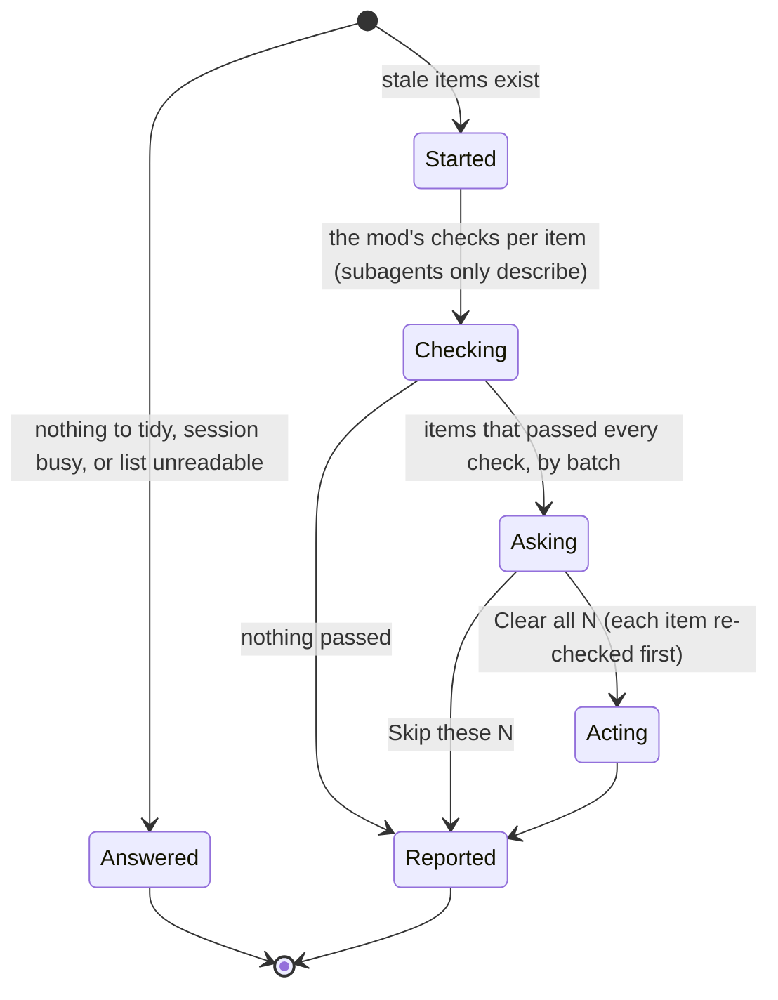

# Interaction

Every guideline in `docs/ux/interaction-guidelines.md` is still `unresolved`. Each row cites the rule area it proposes a default for (`IG: <area>`); the owner accepts or changes them at the gate. Milestone 1's [interaction.md](../../2026-11-13-agent-tracker/spec/interaction.md) holds for everything not named here.

What the pane can do, as built (`pane/view.tsx`, `pane.tsx`): every move is a Button; Tab and the arrows move the ring (the footer says "↑↓ move"); no page scrolls, so a page taller than the window is a risk the render check must name by row count, Enter presses; rows and actions are Buttons in blocks; no modal dialog exists in the code, so the one confirm of this change is an inline offer on the page. **No hotkey is shown or bound** (owner, 2026-11-14, and `docs/ux/setup.md` for the band). The key route of every control is therefore "Tab to it, Enter". The menu route is a `/tracker` word, or none where the spec says why.

New command words: `tidy`. The help and hint strings name it (screens.md, Words).

Session facts the controls depend on (verified by the owner on 2026-11-14, see the task brief and the handover): `claude agents --json` interactive rows carry `pid` and `status`; background rows carry `state`; an exited background row keeps `state: blocked` and has no `pid`; `claude stop <id>` fails for it ("No job matching"); `claude rm <id>` removes it ("removed <id>") and deletes only a worktree the session itself created, if safe. The tracker never calls `claude stop`.

## Wireflows

### J1 Trust the needs-you list

| From control | Action | To screen or state | Notes |
|---|---|---|---|
| (none) | a background session exits; its row stays `blocked` with no `pid` | Home: the session leaves NEEDS YOU; the band's count drops it | Within one read (5 seconds). No control is involved: the fix is in the state rule. |
| Repo page: Ended row, or Home task row of the session | Enter | Session page: "○ ended 63d ago" | The page no longer says "waiting". |

### J2 See an old session's real age

| From control | Action | To screen or state | Notes |
|---|---|---|---|
| Band: Pane button | Enter | Home | |
| Home: task row or session row | Enter | Session page | First line: "branch main  started 12 Sep 16:13  last activity 63d ago"; header right: "○ ended 63d ago". |

### J3 Clear a session and its open tasks

| From control | Action | To screen or state | Notes |
|---|---|---|---|
| Home: task row of an ended session | Enter | Session page, ended, something to clear | The tasks line shows what Clear will close. |
| Session page: Clear | Enter | Session page, Clearing, then Cleared (or Failed, or PartlyCleared) | One press, no confirm: the conversation stays resumable. Result lines say what happened. |
| Prompt: `/tracker session <text>` | Enter | the same Session page | The keyboard route into the same flow. |

### J4 Remove the merged worktree

| From control | Action | To screen or state | Notes |
|---|---|---|---|
| Session page: Clear | Enter | Cleared, then the worktree offer | Shown only when all five conditions hold. Focus goes to Keep worktree. |
| Offer: Remove worktree | Enter | Removing, then Done (or OfferFailed) | The one confirm. Re-checks the five conditions first. The branch stays. |
| Offer: Keep worktree | Enter | Done | The offer goes away for this visit. |

### J5 Tidy many

| From control | Action | To screen or state | Notes |
|---|---|---|---|
| Home: Tidy (last line) | Enter | the pane closes; the tidy pass runs in this session's transcript | The same as typing `/tracker tidy`. |
| Prompt: `/tracker tidy` | Enter | the tidy pass | |
| Transcript: batch question | answer "Clear all N" or "Skip these N" (or type exceptions under Other) | the next batch, then the report | One question per batch. |

### J6 Leave running work alone

| From control | Action | To screen or state | Notes |
|---|---|---|---|
| Home: session row of a running or waiting session | Enter | Session page, live | No Clear is drawn. One line says what to do instead. Copy resume command is not drawn either. |
| (none) | the tidy pass meets a session with a process | the report's "Skipped" line | Running sessions are never collected; a worktree with a live session in it is skipped and named. |

## State Tables

### Session page (the delta; the rest is milestone 1 as built)

Words: `screens.md`, Pane, Session.

| State | Entry or trigger | What the user sees | Words | Actions with key | Exit |
|---|---|---|---|---|---|
| Live, interactive | the row has a `pid` and `kind` interactive | the page as before; the first line reads started and last activity; no Clear, no Copy resume command; one line | Reason, interactive | Tab, Enter on the crumbs, Back, Close | the process exits |
| Live, background | the row has a `pid` and `kind` background (working or blocked) | the same; the line says it is still running | Reason, background | as above | the process exits |
| Ended, something to clear | no process, and at least one of: still in Claude Code's list; an open task; a worktree that passes the five conditions | state "○ ended 63d ago"; the tasks line (only the tasks Home lists, with their Home glyph and word); the worktree line; above the actions, one line saying what Clear will do (it names the count of tasks, and that Claude Code also removes a worktree it made for the session when that is safe); actions "Copy resume command" then "Clear" | Actions; Before Clear | Tab, Enter: Clear, Copy resume command | Clearing |
| Clearing | Clear pressed | the session list is re-read first; the actions row is replaced by a dim line "Clearing…"; no button | Clearing | none (the ring rests on the first crumb; a second press lands on nothing) | Cleared, Failed, PartlyCleared, Refused |
| Refused, unreadable | the re-read at the press fails | one line: "Clear waits: Claude Code's session list could not be read. Nothing was changed." | List unreadable | none | the next read works |
| Refused | the re-read shows the row has a `pid` again | one line: "This session is running again. Nothing was changed."; the page redraws as Live | Refused | none | Live |
| Cleared | every step that had work succeeded | result lines (one per step that ran), under the offer when there is one; the actions row returns with "Copy resume command" (only while the worktree folder exists) and "Reopen tasks" (when tasks were closed). The lines are page-local: they stay until the owner leaves the page and survive the 5-second re-read (a build test); a fresh visit shows "Nothing to clear" instead. Focus goes to Keep worktree when there is an offer, else to Copy resume command when it is drawn, else to the Home crumb; never to Reopen tasks. | Result | Tab, Enter: Copy resume command, Reopen tasks | Offer, Done |
| Reopened | Reopen tasks pressed | the closed tasks are open again (their `closed` marks removed from the tracker's settings); one line "✓ 2 tasks reopened."; the session stays out of Claude Code's list | Result | Tab, Enter: Copy resume command | Done |
| Failed | `claude rm` failed | one error line (event, consequence, action); Clear is back; nothing else changed | Error, rm | Tab, Enter: Clear again | Clearing |
| PartlyCleared | `claude rm` worked, saving the closed tasks failed | the session left the list; one error line; Clear is back and does the rest | Error, save | Tab, Enter: Clear again | Clearing |
| Offer | a worktree passes all five conditions after the steps | directly under the actions row, three lines naming the worktree by its folder and branch, and why it is safe; buttons "Remove worktree", "Keep worktree"; focus on Keep worktree | Offer | Tab, Enter on either | Removing, Done |
| Removing | Remove worktree pressed | the offer is replaced by "Removing worktree…" | Removing | none | Done, OfferFailed |
| OfferFailed | a condition changed since the offer, or git refused | one error line; nothing removed | Error, worktree | Tab, Enter: Copy resume command | Done |
| Worktree stays | the session's `cwd` is a linked worktree and a condition fails | one line naming the first failed condition | Stays | none | the condition changes |
| Nothing to clear | no process; not listed; no open task; no offer | one line; only Copy resume command | Nothing to clear | Tab, Enter: Copy resume command | a task appears |
| Pid not reported | no row in a good read carries a `pid` | Clear is not drawn; one line | Pid not reported | none | a read with a `pid` |
| List unreadable | the session list failed twice (snapshot stale) | Clear is not drawn; one line | Unreadable | none | the next read works |
| Partial | `gh` missing, so condition 4 cannot use the PR | the worktree line uses the branch's merged state only; if that is not merged: "Worktree stays: its branch is not merged." | Stays | none | gh works |
| From transcript | a session without the mod (the page is built from its transcript) | as Ended; tasks are "not classified", so the confirm-free Clear closes none | Result | as Ended | |

### Home (the delta)

| State | Entry or trigger | What the user sees | Words | Actions with key | Exit |
|---|---|---|---|---|---|
| No tidy line | nothing is idle 30 days or more | the page as before | none | none | something goes idle |
| Tidy line | at least one stale item | last block, below REPOS and above the "without the tracker" line: heading TIDY, one dim count line, button "Tidy" | Tidy line | Tab, Enter: Tidy | pressed, or items cleared |
| Tidy line, waiting | Claude is replying in this session, or the list is stale | the same line without the button; one dim reason | Tidy waits | none | the turn ends, the read works |
| Narrow | pane below 70 columns (a dock) | the count line wraps (`wrap`); the button on its own line; the ring still starts on the first row, never on Tidy | as Tidy line | as above | wider |

### The tidy pass (surface: the owner's transcript)

| State | Entry or trigger | What the user sees | Words | Actions | Exit |
|---|---|---|---|---|---|
| Nothing to tidy | `/tracker tidy`, no item that is idle 30 days and passes every check | one answer line; no turn starts | Tidy answers | none | |
| This session busy | Claude is replying in this session | one answer line; no turn starts | Tidy answers | none | |
| List unreadable | the session list failed twice | one answer line; no turn starts | Tidy answers | none | |
| Started | stale items exist | an answer line with the counts; then Claude's own turn begins; the supervisor names how many items it checks | Tidy answers; Supervisor lines | none | Asking, Reported |
| Asking | a batch has items that passed every check | one question per batch (sessions first, then worktrees) with the items listed and two options | Batch question | answer; or type exceptions under Other | Acting, Skipped |
| Acting | the owner said "Clear all N" | item by item, each re-checked right before; one line per item | Supervisor lines | none | Reported |
| Skipped | the owner said "Skip these N" | one line | Supervisor lines | none | Reported |
| Reported | all batches answered, or none to ask | the report: what was cleared and removed, what was kept and why, what was skipped | Report | none | |

## State Diagrams

Clear, as states of the Session page, is in [ia.md](ia.md). The tidy pass:

## Elements x Interactions

"nothing" means the element ignores the gesture. No element accepts drag, drop or right-click: the mod draws no menus and takes no files. A double-click is two Enter presses or two clicks; the table says what the second one does, because Clear changes the layout under the pointer.

| Screen | Element | Click | Double-click | Drag | Drop onto | Hover | Right-click / More | Keys | Selection | Rules |
|---|---|---|---|---|---|---|---|---|---|---|
| Session | Reopen tasks button (after Clear) | reopens the tasks once | the second press is ignored | nothing | nothing | nothing | nothing | Tab to it, Enter | nothing | IG: confirmation and undo |
| Session | Clear button | runs the steps once | the second press is ignored while "Clearing…" shows, and the button is gone after it | nothing | nothing | nothing | nothing | Tab to it, Enter | nothing | IG: confirmation and undo; progress and long operations |
| Session | Copy resume command button (ended sessions only) | copies, toast | copies twice | nothing | nothing | nothing | nothing | Tab to it, Enter | nothing | IG: copy and paste |
| Session | Remove worktree button (offer) | re-checks, then removes once | the second press is ignored while "Removing worktree…" shows | nothing | nothing | nothing | nothing | Tab to it, Enter | nothing | IG: confirmation and undo |
| Session | Keep worktree button (offer) | closes the offer | closes once | nothing | nothing | nothing | nothing | Tab to it, Enter | nothing | IG: confirmation and undo |
| Session | tasks line, worktree line, reason line, result lines | nothing (text only) | nothing | nothing | nothing | nothing | nothing | ↑↓ move the ring; no scroll | nothing | IG: lists and selection |
| Session | crumbs, Back, Close | as milestone 1 | as milestone 1 | nothing | nothing | nothing | nothing | Tab, Enter | nothing | IG: navigation and return |
| Home | Tidy button | closes the pane and runs `/tracker tidy` | runs once (the pane is already closed) | nothing | nothing | nothing | nothing | Tab to it, Enter | nothing | IG: side panels and detail pages |
| Home | Tidy count line | nothing (text only) | nothing | nothing | nothing | nothing | nothing | ↑↓ move the ring | nothing | IG: lists and selection |
| Home | task row, session row (unchanged) | opens the Session page | opens once | nothing | nothing | nothing | nothing | Tab, Enter | one focused row | IG: lists and selection |
| Transcript | batch question | the owner answers by choosing an option or typing under Other | n/a | nothing | nothing | nothing | nothing | the host's own keys | single choice | IG: dialogs, menus and popovers |

**Layout under the pointer.** Clear removes itself; the worktree offer appears directly under the actions row, above the result lines (so it is on screen without scrolling), three rows below where Clear was. Remove worktree is never first in the ring. Focus goes to Keep worktree when the offer appears. Build check: a second click at the pointer's old position lands on nothing, and no button the layout shifts under it runs Remove worktree.

## Action Behaviour

| Action | Pointer route | Keyboard route | Menu route | Save | Leave | Undo | Guideline |
|---|---|---|---|---|---|---|---|
| Clear an ended session | click Clear | Tab to Clear, Enter | `/tracker session <text>`, then Tab, Enter (no one-shot command, on purpose) | the session list is re-read first; then Claude Code's list changes (`claude rm`, only if still listed) and the open tasks are closed at once, as the task Close does | steps in flight finish; on return the page shows what is left | "Reopen tasks" while the owner is on the page (it removes the `closed` marks); the conversation stays resumable while its folder exists (Copy resume command); the list row does not come back | IG: confirmation and undo (no confirm; a line before the press says what it does, and the undo is one press) |
| Reopen the tasks | click Reopen tasks (after Clear, while on the page) | Tab to it, Enter | none | removes the `closed` marks Clear wrote, in the tracker's settings file (a new write beside the existing Close) | leaving: the button is gone; the tasks stay as they are | Clear again | IG: confirmation and undo |
| Remove the worktree | click Remove worktree | Tab to it, Enter | none | `git worktree remove`, never forced; ignored files go with it; the branch stays | leaving while it runs: it finishes | recreate it from the branch (`git worktree add`); ignored files do not come back | IG: confirmation and undo (one confirm: this offer) |
| Keep the worktree | click Keep worktree | Tab to it, Enter | none | nothing | nothing | the offer returns when Clear is pressed again | IG: confirmation and undo |
| Start a tidy pass | click Tidy on Home | Tab to Tidy, Enter | `/tracker tidy` | nothing until the owner answers a batch | the pass runs in the transcript; typing a new prompt waits as for any turn | each removal inside it is undone as above; a "Skip" answer changes nothing | IG: local work and external writes |
| Copy resume command | click it | Tab to it, Enter | none | clipboard | nothing | not needed | IG: copy and paste (unchanged) |

## Feedback

| Action | Feedback | Reason | Where shown |
|---|---|---|---|
| Clear | visible: "Clearing…", then result lines on the page | the owner needs to see which of the steps ran, next to the tasks they closed; a toast would vanish | Session page, under the actions |
| Remove worktree | visible: "Removing worktree…", then one result line | it is the irreversible-looking act; the line stays | Session page |
| Reopen tasks | visible: "✓ 2 tasks reopened." | the owner needs to see it worked | Session page |
| Keep worktree | silent: the offer closes | the change is the feedback | Session page |
| Tidy start | visible: the command's answer line, then Claude's own turn | the owner started it; the transcript is the log | transcript |
| Tidy batch | ask first: one question per batch | each yes removes things | transcript |
| Tidy end | visible: the report | the owner needs to know what was kept and why | transcript |
| Copy resume command | visible: toast (unchanged) | the clipboard shows nothing | toast |
| A needs-you row disappears because its process is gone | silent | the list is the feedback; no notification | Home, band |

## Errors

Every error reads event, consequence, action; the exact strings are in `screens.md`, Words.

| Event | Consequence | Action |
|---|---|---|
| `claude rm` failed for this session (Claude Code said no, or the command is missing). | Nothing else was changed: the tasks are still open and the worktree untouched. | Press Clear to try again. |
| The closed tasks could not be saved (the tracker's settings file is not writable). | The session left Claude Code's list; its tasks are still open. | Press Clear again once the tracker's folder in your Claude folder can be written. |
| Git could not remove the worktree, or its state changed since the offer. | Nothing was removed; no work was lost. | Check it in a terminal, or press Clear again to see the conditions. |
| The session showed a process again when Clear was pressed. | Nothing was changed. | None: it is running again; Clear returns when it ends. |
| A tidy item passed its re-check and its action still failed (`claude rm` or git refused). | That item is not counted as cleared; the report names it with the reason. | Open its page and decide there. |
| Claude Code's session list could not be read twice in a row. | Clear is withheld: whether the session still has a process is not known. | It retries every 5 seconds. |
| `git` could not read the worktree (a folder that was deleted by hand, or not a repository). | No worktree line or offer is drawn for it. | Nothing to do; Clear still closes the tasks. |
| `/tracker tidy` ran while Claude was replying in this session, or the list was unreadable. | No pass started; nothing changed. | Try again when Claude has finished replying, or in a minute. |
| A tidy item failed its re-check just before acting (it changed since the check). | That item is skipped and named in the report; the rest go on. | Open its page and decide there. |

## Open Questions

| Question | Recommended answer | Why it matters |
|---|---|---|
| Should "Remove worktree" be unreachable by mouse for the first second after it is drawn? | No: it is never first in the ring and sits three rows below where Clear was. Check the layout at build. | A double-click must not turn Clear's result into a confirmed removal. |
| Should the result lines be kept after the owner leaves the page? | No: the page shows what is left ("Nothing to clear"), which is the same fact. They do stay while the page is open. | The tracker stores no "cleared" mark. |
| Should Escape cancel the offer? | Escape only returns the keys to the prompt (milestone 1); the offer stays and does nothing until a button is pressed. Keep worktree is the cancel. | Consistent with the pane's existing Escape rule. |
