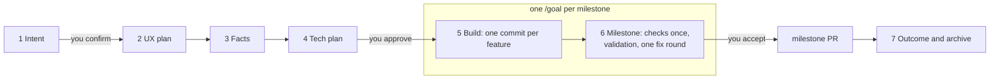
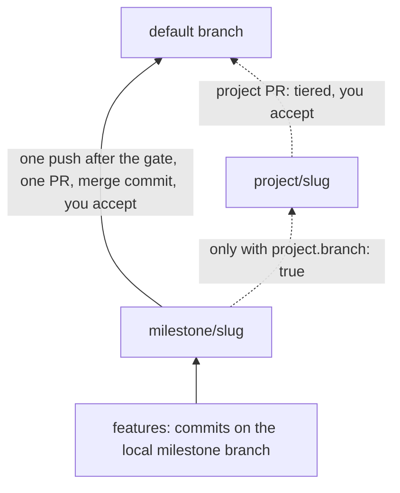

# sdlc-run, end to end

Describes sdlc-run 3.20.0.

`/cct:sdlc-run` runs an AI-native software lifecycle in any repo. The agent drafts the intent, the UX plan, the facts and the tech plan. You confirm twice. Then one `/goal` builds the whole milestone as commits, runs the heavy checks once, and opens one PR.

Verification and every push follow the [local-first contract](../plugins/cct/skills/sdlc-run/references/local-first.md); read it before running checks or preparing a push. The runbook the agent follows is in [`plugins/cct/skills/sdlc-run/`](../plugins/cct/skills/sdlc-run/) (`SKILL.md`, `references/stages.md`, `references/ci-blueprint.md`, `references/adopt.md`).

## Where to start reading

One change folder, `changes/<date>-<slug>/`, holds everything: nothing lives only in a chat. Its `README.md` is a generated map. It answers three questions, each with one file:

- **What are we building, and why?** Read `intent.md`.
- **Is it right?** Read `facts.md`, then `plan.md`.
- **Where did the work stop?** Read the stage in the README and the latest `handover*.md`.

Everything else in the folder is a working file for agents. If a sentence names an id such as F3 or Q7, `sdlc_status.py ids <change>` says what it means and which file decides it.

## The seven stages



The two touchpoints are the intent and the plan. After the plan is approved, `lock.json` locks the facts, `done.json` and the checks; only your words can open them. The times are typical for a medium change, not promises. The example is one invented change throughout: "sort the invoice list by date".

### 1 Intent

- **You get:** `intent.md` with your asks word for word, job stories, the success measure and the rules that apply.
- **Who acts:** the agent drafts after one dialog (ticket, design, size, kind, milestone, project); **you confirm**.
- **Typical time:** 10 to 20 minutes.
- **Example:** your words "I can't find the newest invoice" become the ask A1, the job story "when I open the list I want newest first", and the measure "support questions about finding invoices drop by half in a month".

### 2 UX plan

- **You get:** `spec/`: screens, states, words and components, planned against the repo's design rules, and `spec/readiness.md`, the verdict that the design is ready. Images of the screens only when the plan marks the UI risky. Skipped for size `none` or `ux: off`.
- **Who acts:** the agent, with review agents.
- **Typical time:** 30 to 60 minutes.
- **Example:** one screen (the invoice list) with the states "empty", "loading" and "sorted", and the new column header named "Date".

### 3 Facts

- **You get:** `facts.md`: short testable sentences. Each cites its ask, names its screen or state and names the E2E test tag that proves it.
- **Who acts:** the agent drafts; a reviewer in a fresh context writes `checklist.md`.
- **Typical time:** 10 to 20 minutes.
- **Example:** "When the list opens, the system shall show the newest invoice first (A1)".

### 4 Tech plan

- **You get:** `plan.md`: where the code goes, the milestones and the feature rows, and `done.json`, which holds "done" as data. An analyze pass and a challenge pass argue against it first.
- **Who acts:** the agent drafts; **you approve** the UX plan, the facts and the plan in one review. Then `verify_gate.py approve` writes `lock.json`.
- **Typical time:** 15 to 30 minutes to draft, plus your review.
- **Example:** two features: "sort the rows" and "remember the sort in the URL", each with its facts.

### 5 Build

- **You get:** one commit per feature on `milestone/<slug>-<n>`, and `questions.md` with every open question and the default taken.
- **Who acts:** the agent, inside one `/goal`. Builders write each feature's tests first, then the code; the touched tests and the repo's pre-commit checks run between features. A question never stops the build.
- **Typical time:** 20 to 60 minutes per feature; a few hours for a milestone of four to six.
- **Example:** commit "feat: sort the invoice list by date", then the next feature starts at once.

### 6 Milestone

- **You get:** one PR with the report. Code review (Claude and Codex), UX review, accessibility, the full E2E suite once, every fact exercised in the built app (`validation.md`), `findings.md` with one fix round, and `verify_gate.py milestone` on a frozen head.
- **Who acts:** the agent, in the same `/goal`; **you accept** (in one go only when a critical or high finding would be deferred).
- **Typical time:** 30 to 90 minutes, mostly the E2E suite.
- **Example:** `validation.md` shows the fact above as "met", with the test and the screenshot as evidence.

### 7 Outcome

- **You get:** the folder archived once the change reaches the default branch, a short `reflection.md` and, after release, the success measure read where `intent.md` says.
- **Who acts:** the agent archives; **you read** the measure.
- **Typical time:** a minute to archive; the measure is read days or weeks later.
- **Example:** "support questions about finding invoices: down 55 percent in 30 days, target met". A miss starts the next change.

A project, work that spans several milestones, adds stage 6p: after the last milestone merges, the milestone checks run once more on the whole project, and **you accept** the project.

## One /goal per milestone

`delivery: "one-go"` is the default in `sdlc.json`. Everything you asked for at once is one change. One `/goal` builds every milestone in the plan, in order, each on its own local branch `milestone/<slug>-<n>` cut from the default branch, so it merges on its own. Only a milestone whose plan row says `needs: M<k>` is cut from that one; it builds at once and opens its PR after that one merges. Nothing is pushed before the milestone's gate passes. Each feature is a commit. The full suite runs once on the final milestone head before push; failure diagnosis stays targeted.

`delivery: "feature-prs"` keeps the older shape: one PR per feature, auto-merged into the milestone branch. It suits teams building features in parallel.

Builders are `cct:sdlc-feature-builder` agents, at most four at once, each in its own worktree and test slot. Each gets a `Base: <sha>` line, the milestone head, and resets to it before any edit, because a worktree hook cuts from the default branch. The supervisor commits its records first, edits no code, runs no test suite, and merges builder branches back one at a time. The close is one `cct:builder` with `Mode: close`; nothing merges while it runs.

## Branches, commits and PRs



```
<default> ─── milestone/<slug>-<n> ─── <feature commits>              one milestone, or each milestone of a project
<default> ─── project/<slug> ─── milestone/<slug>-<n> ─── <features>  a project that asked for a branch
```

**Commits, not PRs.** While a milestone is open, everything that belongs to it is a commit on `milestone/<slug>`: features, fixes found during the build, test and flaky-spec repairs, CI timeout tweaks its tests need, and records (plans, handovers, gate lines, `findings.md`, `validation.md`, `questions.md`). No PR holds only a record, a fix or a test repair.

**PRs that exist:**

- The milestone PR, into the default branch (or `project/<slug>` when the project has a branch).
- The project PR, only when the project has a branch.
- Feature PRs, only with `delivery: "feature-prs"`.
- Other repositories, and a change you send to the default branch first.

**Only the PR into the default branch is tiered.** Everything below it is an interior merge inside one change and auto-merges on its checks alone. The code review is not a PR step at all: it runs once, locally, at the milestone close. Nothing runs Claude in CI, so no repo needs `ANTHROPIC_API_KEY`.

| PR | Checks | Ship/Show/Ask | Who approves |
|---|---|---|---|
| feature to `milestone/*` (`feature-prs` only) | feature checks | no | nobody; auto-merge on green |
| milestone to `project/*` | milestone checks | no | nobody; auto-merge on green |
| `project/*` or `milestone/*` to the default branch | milestone checks | yes | the tier decides |

Acceptance is separate from PR approval: you accept each milestone at stage 6, and the project at 6p, even though the interior PRs merge themselves. A hotfix goes straight to the default branch with feature checks only.

## The verify contract

`python3 scripts/verify_gate.py feature|milestone <id>` checks `lock.json`, runs the checks named in `sdlc.json`, writes `changes/<id>/verify/report.md`, and ends with exactly one line:

| Last line | The agent |
|---|---|
| `VERIFY PASS <scope> <id> <sha>` | moves on |
| `VERIFY FAIL ... check=<name>` | fixes that check and runs verify again |
| `VERIFY BLOCKED reason=<code>` | stops and asks you |

Blocked reasons: `not-approved`, `protected-path`, `no-progress`, `flaky`, `unknown-verdict`, `needs-baseline`, `allowlist-request`, `scope-growth`, `spec-conflict`, `env`, `test-proves-nothing`.

The agent may never build outside `/goal`, change the approved plan, edit a test to make it pass, start a second fix round at a milestone, decide scope for you, or open a PR for work that belongs to an open milestone.

## Local verification and GitHub setup

The [local-first contract](../plugins/cct/skills/sdlc-run/references/local-first.md) is the
single verification rule for builders, fixes, E2E work, milestone close and PR creation.
Use targeted local runs while diagnosing, then the full suite once before every push.

GitHub Actions required checks are the merge gate; the rulesets require them. Nothing local
(no script, receipt or hook) gates a push or a PR. GitHub also runs deploys, eligible previews,
cloud plans and scheduled work. Required checks are never the debugging loop. A passed PR does
not need a second full CI run on main.

Decision4 is advisory: PRs say how hard the change is to undo (a level per `boundary-map.yaml`, a decision record above Undo). No workflow, status or hook reads it. See [Decision4 in a PR](../plugins/cct/skills/sdlc-run/references/decision4-pr.md).

Follow the [CI setup guide](../plugins/cct/skills/sdlc-run/references/ci-blueprint.md) to
implement and audit the repo-specific gate before replacing required remote checks.
`adopt` preserves existing workflows and reports the manual gate setup. The legacy
`templates/ci/github-actions.yml` is retained for migration/reference, not automatically
installed. `ciPaths` and `ciCommands` still describe affected paths and stack commands;
commands per stack live in the E2E policy's section K.

## How to adopt

Run `adopt` once per repo, from the repo root, on a branch:

```bash
/cct:sdlc-run adopt
```

It first asks whether to use Ship/Show/Ask merge tiers (a code owner approves risky PRs; the right answer for a one-owner repo is no). Then it installs:

- `sdlc.json`, from a preset, including the stack's default `ciPaths` and `ciCommands` (written once, never overwritten; edit the folder names to your repo's own), and the `sdlcVersion` stamp.
- Hooks in `.claude/hooks/` that refuse edits outside `/goal` and to locked files, and `scripts/verify_gate.py`.
- The review and tier workflows, `docs/sdlc.md`, issue and PR templates, and a section for `CLAUDE.md`.

`adopt` preserves existing CI and does not install a remote verification workflow in a repo without one. It points at GitHub's required checks as the merge gate. Re-run it whenever the plugin updates, because the hooks and workflows are copies that do not update themselves.

## Staying current

`adopt` writes `"sdlcVersion": "3.20.0"` into `sdlc.json`. Every time the skill runs in the repo, `status` and the verify gate compare the stamp with the installed plugin and print one line when it is missing or older, for example:

```text
This repo runs sdlc-run 3.2.0; the kit is 3.3.1. Run `adopt --upgrade` (changes: 3.3.1: adopt --upgrade never overwrites or moves anything; 3.3.0: the CI workflow ships as a template, ciPaths by file type, versioned repos).
```

A repo newer than the plugin is told to update the plugin. The verify gate prints it as a `WARN` line and never blocks.

`/cct:sdlc-run adopt --upgrade` is the safe path. It adds the keys a newer plugin introduced with the stack's defaults, never changes a value, stamps the new version and writes nothing else: no file overwritten, no folder moved. Each file that differs from the plugin's copy (a hook, `scripts/verify_gate.py`, `docs/sdlc.md`, the guardrail test) is listed as `review diff`, together with the manual migrations of `references/changelog.md` since your stamp. `adopt --upgrade --replace <file>` shows one file's diff; `adopt --upgrade --apply --replace <file>` replaces that file. A plain `adopt` refreshes every copy at once. `--dry-run` writes nothing.

## What changed since 3.7

Each version's headline and migration steps are in the skill's [changelog](../plugins/cct/skills/sdlc-run/references/changelog.md). The ones a newcomer meets first:

- **Rules, clarify, checklist, analyze, challenge (3.8, 3.9):** standing rules are cited by id; a fresh reviewer writes `checklist.md`, an analyze pass writes `analyze.md` and a challenge pass writes `challenge.md`. `approve` refuses an unchecked item or an open critical.
- **Enforcement audit (3.9):** `verify_gate.py audit` says per gate whether it is installed, configured, executed and passed.
- **Readable folders (3.17):** a generated `README.md` in every change folder, plain words with ids in brackets, `sdlc_status.py ids` and a sentence for what blocks the goal. [More](../plugins/cct/skills/sdlc-run/references/readability.md).
- **Faster hooks, cheaper gates, local milestones (3.18):** each hook starts Python once per call; `verify_gate.py` runs checks cheapest first; `milestones.merge: "local"` keeps milestone and project branches off GitHub until the one PR into the default branch. [More](../plugins/cct/skills/sdlc-run/references/local-first.md#local-milestones).
