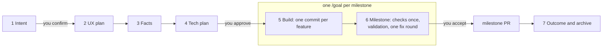
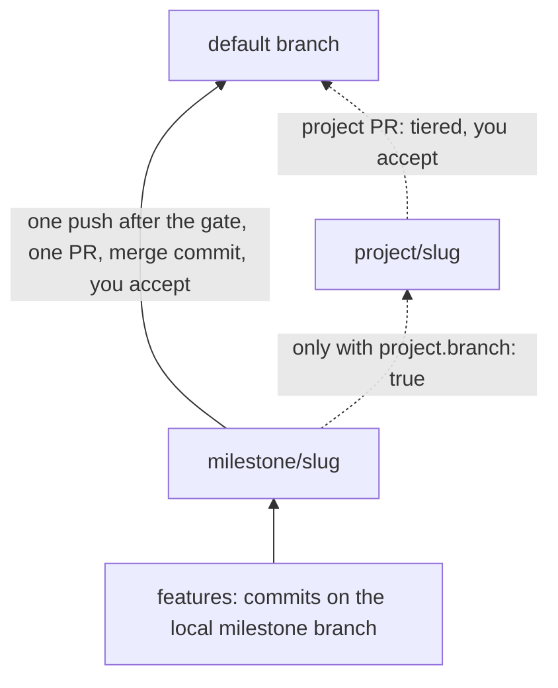

# sdlc-run, end to end

Verification and every push follow the [local-first contract](../plugins/cct/skills/sdlc-run/references/local-first.md); read it before running checks or preparing a push.

`/cct:sdlc-run` runs an AI-native software lifecycle in any repo. The agent drafts the intent, the UX plan, the facts and the tech plan. You confirm twice. Then one `/goal` builds the whole milestone as commits, runs the heavy checks once, and opens one PR.

There is also a [visual version of this page](sdlc-run-explained.html). It is a standalone HTML file: download it and open it in a browser.

Version described: sdlc-run 3.9.0 (the stage walkthrough below was written for 3.7.0; [what 3.8 and 3.9 add](#what-38-and-39-add) is at the end). The runbook it follows is in [`plugins/cct/skills/sdlc-run/`](../plugins/cct/skills/sdlc-run/) (`SKILL.md`, `references/stages.md`, `references/ci-blueprint.md`, `references/adopt.md`).

## Stages and the two touchpoints



One change folder, `changes/<date>-<slug>/`, holds everything: intent, `spec/`, facts, plan, `done.json`, `lock.json`, `milestone.md`. Nothing lives only in a chat.

| Stage | What happens | Who |
|---|---|---|
| 1 Intent | One dialog picks ticket, design, size, kind, milestone and project. The agent drafts `intent.md`: your asks word for word, job stories, the success measure. | **You confirm** |
| 2 UX plan | Screens, states, words and components, planned against the repo's design rules. Skipped for size `none` or `ux: off`. | agent |
| 3 Facts | Short, testable sentences. Each cites an ask, names its screen or state, and names the E2E test that proves it. | agent |
| 4 Tech plan | Where the code goes and how the work splits into features. `done.json` holds "done" as data. | **You approve** stages 2, 3 and 4 in one review |
| 5 Build | Per feature: write its tests, build, commit, start the next at once. Run the touched tests and required pre-commit checks between features; reserve the full gate for the final head before push. Open questions go to `questions.md` with the default taken and never block. | agent, inside `/goal` |
| 6 Milestone | Code review (Claude and Codex, the only one: nothing reviews in CI), UX review, accessibility, the full E2E suite once, every fact exercised in the built app, one fix round, `verify_gate.py milestone` on a frozen head, one push, one PR merged with a merge commit. | agent, inside `/goal`; **you accept** (in one go only when a Critical or High finding would be deferred) |
| 6p Project | Only for work spanning several milestones, after the last one merged: the milestone checks once more on the whole project, on the default branch. No PR. With a project branch: merge the default branch in, same checks, one PR. | **you accept** |
| 7 Outcome | Archive the folder when the change reaches the default branch. After release, read the success measure. A miss starts the next change. | agent, you read it |

The two touchpoints are the intent and the plan. After the plan is approved, `lock.json` locks facts, `done.json` and the checks; only your words can open them.

## One /goal per milestone

`delivery: "one-go"` is the default in `sdlc.json`. Everything you asked for at once is one change. One `/goal` builds every milestone in the plan, in order, each on its own local branch `milestone/<slug>-<n>` cut from the default branch, so it merges on its own. Only a milestone whose plan row says `needs: M<k>` is cut from that one; it builds at once and opens its PR after that one merges. Nothing is pushed before the milestone's gate passes. Each feature is a commit. The full suite runs once on the final milestone head before push; failure diagnosis stays targeted.

`delivery: "feature-prs"` keeps the older shape: one PR per feature, auto-merged into the milestone branch. It suits teams building features in parallel.

Builders are `cct:builder` agents, at most four at once, each in its own worktree and test slot. Each gets a `Base: <sha>` line, the milestone head, and resets to it before any edit, because a worktree hook cuts from the default branch. The supervisor commits its records first, edits no code, runs no test suite, and merges builder branches back one at a time. The close is one `cct:builder` with `Mode: close`; nothing merges while it runs.

## Branches, commits and PRs



```
<default> ─── milestone/<slug>-<n> ─── <feature commits>              one milestone, or each milestone of a project
<default> ─── project/<slug> ─── milestone/<slug>-<n> ─── <features>  a project that asked for a branch
```

**Commits, not PRs.** While a milestone is open, everything that belongs to it is a commit on `milestone/<slug>`: features, fixes found during the build, test and flaky-spec repairs, CI timeout tweaks its tests need, and records (plans, handovers, gate lines, `findings.md`, `validation.md`, `questions.md`). No PR holds only a record, a fix or a test repair.

**PRs that exist:**

- The milestone PR, into the default branch (or `project/<slug>` when the project has a branch).
- The project PR, only when the project has a branch.
- Feature PRs, only with `delivery: "feature-prs"`.
- Other repositories, and a change you send to the default branch first.

**Only the PR into the default branch is tiered.** Everything below it is an interior merge inside one change and auto-merges on its checks alone. The code review is not a PR step at all: it runs once, locally, at the milestone close. Nothing runs Claude in CI, so no repo needs `ANTHROPIC_API_KEY`.

| PR | Checks | Ship/Show/Ask | Who approves |
|---|---|---|---|
| feature to `milestone/*` (`feature-prs` only) | feature checks | no | nobody; auto-merge on green |
| milestone to `project/*` | milestone checks | no | nobody; auto-merge on green |
| `project/*` or `milestone/*` to the default branch | milestone checks | yes | the tier decides |

Acceptance is separate from PR approval: you accept each milestone at stage 6, and the project at 6p, even though the interior PRs merge themselves. A hotfix goes straight to the default branch with feature checks only.

## The verify contract

`python3 scripts/verify_gate.py feature|milestone <id>` checks `lock.json`, runs the checks named in `sdlc.json`, writes `changes/<id>/verify/report.md`, and ends with exactly one line:

| Last line | The agent |
|---|---|
| `VERIFY PASS <scope> <id> <sha>` | moves on |
| `VERIFY FAIL ... check=<name>` | fixes that check and runs verify again |
| `VERIFY BLOCKED reason=<code>` | stops and asks you |

Blocked reasons: `not-approved`, `protected-path`, `no-progress`, `flaky`, `unknown-verdict`, `needs-baseline`, `allowlist-request`, `scope-growth`, `spec-conflict`, `env`, `test-proves-nothing`.

The agent may never build outside `/goal`, change the approved plan, edit a test to make it pass, start a second fix round at a milestone, decide scope for you, or open a PR for work that belongs to an open milestone.

## Local verification and GitHub setup

The [local-first contract](../plugins/cct/skills/sdlc-run/references/local-first.md) is the
single verification rule for builders, fixes, E2E work, milestone close and PR creation.
Use targeted local runs while diagnosing, then the full suite once before every push.

GitHub Actions required checks are the merge gate; the rulesets require them. Nothing local
(no script, receipt or hook) gates a push or a PR. GitHub also runs deploys, eligible previews,
cloud plans and scheduled work. Required checks are never the debugging loop. A passed PR does
not need a second full CI run on main.

Decision4 is advisory: PRs say how hard the change is to undo (a level per `boundary-map.yaml`, a decision record above Undo). No workflow, status or hook reads it. See [Decision4 in a PR](../plugins/cct/skills/sdlc-run/references/decision4-pr.md).

Follow the [CI setup guide](../plugins/cct/skills/sdlc-run/references/ci-blueprint.md) to
implement and audit the repo-specific gate before replacing required remote checks.
`adopt` preserves existing workflows and reports the manual gate setup. The legacy
`templates/ci/github-actions.yml` is retained for migration/reference, not automatically
installed. `ciPaths` and `ciCommands` still describe affected paths and stack commands;
commands per stack live in the E2E policy's section K.

## How to adopt

Run `adopt` once per repo, from the repo root, on a branch:

```bash
/cct:sdlc-run adopt
```

It first asks whether to use Ship/Show/Ask merge tiers (a code owner approves risky PRs; the right answer for a one-owner repo is no). Then it installs:

- `sdlc.json`, from a preset, including the stack's default `ciPaths` and `ciCommands` (written once, never overwritten; edit the folder names to your repo's own), and the `sdlcVersion` stamp.
- Hooks in `.claude/hooks/` that refuse edits outside `/goal` and to locked files, and `scripts/verify_gate.py`.
- The review and tier workflows, `docs/sdlc.md`, issue and PR templates, and a section for `CLAUDE.md`.

`adopt` preserves existing CI and does not install a remote verification workflow in a repo without one. It points at GitHub's required checks as the merge gate. Re-run it whenever the plugin updates, because the hooks and workflows are copies that do not update themselves.

## Staying current

`adopt` writes `"sdlcVersion": "3.9.1"` into `sdlc.json`. Every time the skill runs in the repo, `status` and the verify gate compare the stamp with the installed plugin and print one line when it is missing or older, for example:

```text
This repo runs sdlc-run 3.2.0; the kit is 3.3.1. Run `adopt --upgrade` (changes: 3.3.1: adopt --upgrade never overwrites or moves anything; 3.3.0: the CI workflow ships as a template, ciPaths by file type, versioned repos).
```

A repo newer than the plugin is told to update the plugin. The verify gate prints it as a `WARN` line and never blocks.

`/cct:sdlc-run adopt --upgrade` is the safe path. It adds the keys a newer plugin introduced with the stack's defaults, never changes a value, stamps the new version and writes nothing else: no file overwritten, no folder moved. Each file that differs from the plugin's copy (a hook, `scripts/verify_gate.py`, `docs/sdlc.md`, the guardrail test) is listed as `review diff`, together with the manual migrations of `references/changelog.md` since your stamp. `adopt --upgrade --replace <file>` shows one file's diff; `adopt --upgrade --apply --replace <file>` replaces that file. A plain `adopt` refreshes every copy at once. `--dry-run` writes nothing.

## What 3.8 and 3.9 add

Mechanisms are in `references/quality-passes.md` and `references/stages.md` of the skill.

- **Rules (3.8):** `sdlc.json` takes an optional `rules` list of repo files that hold standing rules. Intent lists the rule IDs that apply; every fact cites the IDs it touches.
- **Clarify, checklist, analyze (3.8):** at most 5 clarifying questions, then defaults under `## Assumptions`. A reviewer in a fresh context writes `checklist.md`; an analyze pass writes `analyze.md`. `approve` refuses an unchecked item or an open CRITICAL.
- **Context pack (3.8):** a builder gets its feature's facts, the plan excerpt and the cited rule text, not whole files.
- **Converge and validation block (3.8):** an append-only converge pass at the milestone close; the gate blocks on a `not met` or `partly` row, an open finding and a missing `Converged:` line.
- **Challenge pass (3.9):** before gate 2 a fresh reviewer argues against the change into `challenge.md`; `approve` refuses an open CRITICAL.
- **Enforcement audit (3.9):** `verify_gate.py audit` reports per gate whether it is installed, configured, executed and passed, and whether its CI job is a required status. Run at adopt, at each milestone close and monthly from CI.
- **Reflection and metrics (3.9):** one short `reflection.md` per change at Stage 7; every gate report ends with operational metrics.
- **Code reviewer (3.9):** four design questions on every axis: hidden dependencies, surprising side effects, domain vocabulary, composability.
